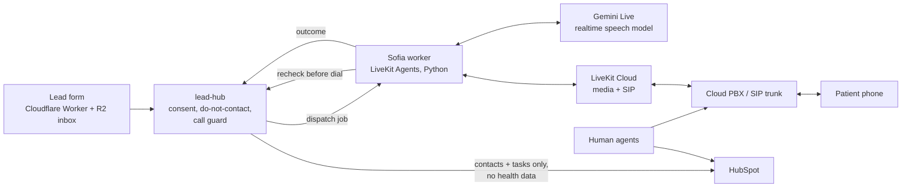

# Sofia — voice AI agent

A phone voice agent built on LiveKit Agents and Gemini Live, built to make first-contact calls to patients for a dental-tourism call center, with hard safety rails around consent, disclosure and who may be called.

**Status: built and tested; pilot on hold.** The dental worker (v0) is built and tested against faked LiveKit, Gemini and back-end services. It has not yet placed real calls; the call center currently runs with human agents first, and Sofia is added once that floor is stable.

> Code is private (client work). This repository is a case study.

---

## The problem

A dental-tourism call center receives consented leads from ads and web forms: patients abroad asking about treatment. Leads go cold when nobody calls back quickly, and the first conversation is mostly the same questions. A voice agent can make that first contact quickly, but a careless one is a legal and reputational risk: it must say it is an AI, must never call someone who withdrew consent, must not collect health data over the phone and must not run outside allowed hours.

## What Sofia does

- Calls consented leads back over SIP, in the patient's language (Italian first).
- Plays a **pre-recorded AI-disclosure clip** before the model is even connected, so the disclosure cannot be skipped or interrupted.
- Answers practical questions from a per-clinic knowledge file and records a structured call outcome for a human agent to pick up in the CRM.
- Honours "stop calling me" immediately: the stop request reaches the lead system (or a durable local spool) before the tool call returns.

## Architecture

The surrounding call-center platform (built in the same project): a public lead form on a Cloudflare Worker that stores submissions in R2 so leads survive outages; `lead-hub`, which owns consent, do-not-contact and the call guard and writes contacts to the CRM; and an encrypted case store for patient files that never touch the CRM.

## Stack

Python 3.12 · LiveKit Agents (pinned) · Google Gemini Live (realtime audio) · LiveKit Cloud SIP · cloud PBX with EU numbers · HubSpot · Cloudflare Workers + R2 · PostgreSQL with row-level security · pytest, mypy strict.

Sofia started as an inbound hotel-concierge voice agent. The dental worker is newly written, shares no code at run time with it, and is a separate deployment (own LiveKit project, own SIP account, own keys) so the two cannot affect each other.

## Notable engineering decisions

- **A call guard that fails closed.** One pure function decides whether Sofia may dial. Missing data, a null, an unknown setting, a timeout or an untrusted system clock (NTP not synchronised) all mean "no". There is no override flag. The database itself refuses an outbound AI call row without a guard decision, and the worker rechecks the guard immediately before dialling.
- **Disclosure before intelligence.** The disclosure clip is verified at startup (SHA-256 against a manifest, 48 kHz mono 16-bit, minimum length) and played on its own audio track before the model session exists. If playback fails, the call ends and the model never speaks.
- **Refuse to start rather than run misconfigured.** A missing or malformed setting, a model id outside the allow-list, a knowledge file that fails its strict schema or a missing clip makes the worker exit with code 78 before it registers for jobs.
- **One patient per room.** After answer, the room must contain exactly one SIP participant; anyone else joining at any time deletes the room and records `room_not_empty`.
- **No health data in the CRM.** The CRM holds contact details and pipeline only. Medical files (X-rays, photos, notes) go to a separate encrypted store: one AES-256-GCM key per file, wrapped by an offline RSA-4096 master key, uploads sealed in the browser, every read audited, and erasure by destroying the file's key.
- **Logs that cannot leak.** A redaction filter on every log handler removes phone numbers, names, tokens and bodies. Undeliverable outcomes are spooled with ids, codes and timestamps only.
- **Non-blocking tools and long-call resilience.** The realtime session runs with non-blocking tool behaviour, session resumption and context-window compression, and with model-side recording off.

---

Code is private (client work). Built by **Z.E Digital Tech** — [zedigital.tech](https://zedigital.tech) · elvizekaj@zedigital.tech
